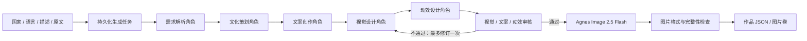

# culture-greetings-web · 多智能体生成架构

## 流程

协调器使用 asyncio 顺序编排，每个角色完成后才启动下一角色，文案读取已完成的文化方案。文本角色均调用 Agnes 2.5 Flash，独立的角色指令及 Pydantic schema 校验隔离职责；无效结构最多修复一次，审核最多修订一次。修订时文案、视觉、动效、审核也顺序执行，视觉读取修订后的文案。网络、认证、额度、图片输出错误不自动重复扣费请求，不回退至预设模板。应用对国家、语言、姓名和用户原祝福实行硬约束；文化意象、节日、风格和负向要求通过方案编写及审核约束。

## AI 控制的 H5 动效

动效角色读取原始描述、需求解析、文化策划、文案与视觉方案，真实调用文本模型生成 `AnimationPlan`。审核角色同时读取这份方案；修订时重新生成动效再审核。图片生成模型仍只负责插画，动画由网页组件执行，未接入视频生成。

方案包括 effect（petals/stars/confetti/fireworks/glow/none）、1–3 个六位十六进制颜色、粒子数、6–20 秒周期、透明度、尺寸、风向、区域及底图运动。粒子数不超过 24，透明度不超过 0.55；不允许任意动画代码、外部素材地址或文本区域。模型可返回无粒子、无底图运动以遵循明确的静止要求。

服务端 Pydantic 和前端入站校验共同约束方案。前端只执行已实现的动画原语，不执行模型代码。粒子位置按作品 ID 确定，参数保存在作品 JSON 中；查看和分享不重新生成动效，重渲染不随机重排粒子。背景图片节点在静态/H5 切换时保持，文字固定。默认静态，H5 时才挂载装饰层，支持系统 reduced-motion 和已有环境动效偏好。

静态旧作品没有 animation 字段时仍可读取，不清空或重画现有图片。本次只扩展作品 JSON，不需要数据库表迁移。

## API

- POST `/api/generations`：创建请求，202 返回随机 job ID。request_id 保证同内容重试不重复排队，不同内容复用 ID 返回 409。
- GET `/api/generations/{id}`：仅返回任务状态、实际角色事件、错误代码及完成后的作品，不返回输入或内部角色成果。
- GET `/api/cards`：page/page_size 分页作品，按时间与 ID 双重倒序。
- GET `/api/cards/{id}`：读取 v3 图片贺卡。
- GET `/api/assets/{id}.png`：只有对应作品存在时才返回 PNG，禁止任意文件路径。
- DELETE `/api/cards/{id}`：删除作品、相关任务和图片。
- POST `/api/cards/bulk-delete`：提交 1–100 个唯一作品 ID，先完整校验，再在一个数据库事务内删除所选作品及相关任务，随后清除对应图片。已不存在的作品不报错，便于安全重试；不会删除未选择的作品。
- GET `/api/health`：数据库状态、提供方与模型名、密钥是否已配置；不返回密钥。

## 数据及生命周期

`card_compositions` 保存 v3 成品 JSON、原用户输入及元数据，`generation_jobs` 保存 request_id、请求摘要、输入、事件和角色成果。外部 API Key 仅从后端环境读取。图片仅接受有上限的 Base64 PNG/JPEG/WebP，经过 Pillow 校验再重编码为 PNG，存入专属图片卷；不直接渲染模型返回的 HTML、SVG、CSS 或远程脚本。

数据库和 API 只有 Compose 内网通信，Web 绑定 127.0.0.1。前端不接触密钥、不保存草稿，生成 URL 只含随机任务 ID。当前没有登录功能，随机地址不是账户鉴权，部署为公共多人服务前需要实现账户、资源权限、配额和 HTTPS。

单个后台队列 worker 串行处理作品，各作品内部角色也顺序执行。服务重启会把旧 running 任务标记为中断，不自动重发可能已产生用量的图片请求；queued 任务继续处理。最长整单 900 秒，单次文本 120 秒、图片 360 秒。客户端仅轮询任务进度，断开不会取消后端生成。

PostgreSQL 从 pgvector 镜像切换为普通 postgres:17，同版本数据库卷继续使用。迁移删除所有旧作品和检索表，并 DROP EXTENSION vector。历史迁移仅用于兼容升级链，运行时代码、依赖和配置均没有向量或本地 AI 模型。
