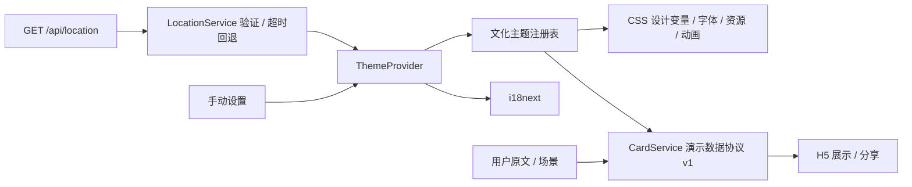

# 系统设计与扩展契约

## 数据流



国家是语言与视觉主题的唯一来源，Provider 仅存储国家及动画偏好，并从主题注册表派生对应语言与主题。所有选择入口均只更新国家；旧偏好的独立语言和主题覆盖被丢弃。用户操作的版本号使正在返回的旧定位响应无法覆盖新选择。已保存国家优先；损坏或未知配置会触发重新识别。文化探索页面已移除，旧路由重定向至首页。

## 定位接口

请求：`GET /api/location`，响应 JSON：

```typescript
interface LocationResponse {
  country: string // ISO alpha-2，如 CN/JP/US/GB/FR；未知映射至 GLOBAL
  language: string // 支持的 BCP 47 locale
  source?: 'mock' // 本地模拟显式标记；真实服务不返回 mock
}
```

超时 3500ms；HTTP、JSON、结构与网络异常均回退 Global。语言固定采用国家文化配置，不接受独立覆盖。默认模拟 CN 由 `vite.config.ts` 集中配置。真实 IP 服务应由服务端根据可信代理头或连接来源识别，避免信任客户端任意提供的国家。VPN 与代理不保证可识别，应始终提供手动切换。

## 主题协议

`CultureTheme` 是唯一主题契约，包含 country、language、colors、typography、assets、animation、culture。primary、secondary、background 保留需求规定的颜色；accent 为可读性优化后的按钮/文字色，防止浅粉或金色按钮白字对比不足。页面组件只消费主题与翻译。每个国家新增一个配置对象与资源，不复制页面。

进入动画与环境动画分别由主题 entrance / ambient 描述；首页共用 GSAP 入场，环境元素通过 ambient CSS 类选择，后续可扩展独立入场注册表。文化文字采用本地 JSON 管理，视觉符号与节庆原名保存在文化配置中。

## 贺卡协议

`Card` v1 包含 id、country（生成时的国家快照）、language、recipient、sender、message、occasion、createdAt、version。创建时由 country 派生 language；读取旧卡片与分享链接时按国家纠正不匹配的语言。贺卡自身的系统文字也固定使用该国对应语言；用户填写的原文保留。当前的“生成”是本地预览，没有生成式内容。切换全站国家不会修改已保存贺卡的国家快照。

分享通过 UTF-8 → Base64URL 组成 `/card/:id?d=<payload>`。解码后检查版本、支持的主题、语言、场景、字段类型与长度、时间格式、ID。分享数据只作为 React 文本渲染，禁止 innerHTML。有效分享内容优先于本机数据；损坏链接回退到同 ID 本机记录，否则展示空状态。

Base64URL 是编码，不是加密。当前适合演示，不具备访问控制、可撤销链接、审计或服务端存储。下一阶段可替换为不透明分享 ID，使用服务端签名/权限和内容存储。

## 未来服务边界

```typescript
interface GenerationRequest {
  culture: string
  locale: string
  occasion: string
  userText: string
}
interface GenerationJob {
  id: string
  status: 'queued' | 'understanding' | 'designing' | 'rendering' | 'completed' | 'failed'
  progress: number
  cardId?: string
  error?: { code: string; retryable: boolean }
}
```

这些仅为扩展建议，当前未引入后端框架。未来用服务端创建生成任务，SSE/轮询替换演示定时器；文化知识库与向量检索置于服务端；图片生成产物以受控资源 URL 写入卡片协议；用户系统与后台共享 API 权限和版本化 schema。

## 非功能约束

- TypeScript strict；路由懒加载，Lottie 仅在模拟生成页加载。
- 无外部图片/字体依赖，首次打开即可展示全部文化视觉。
- 语义按钮、表单可访问标签、键盘焦点、移动菜单、系统减少动效。
- 本地存储读取/写入均可容错；不解析并执行贺卡中的 HTML。
- 本阶段未使用 Docker Compose 或 Python 依赖。

## 验证

`npm test` 覆盖协议损坏、大小限制、跨语言分享往返、空白消息、未知国家回退、五份资源键完整性和定位错误。`npm run build` 执行严格类型检查与生产打包。完整交互与响应式仍需浏览器验证，不能用构建成功替代。
